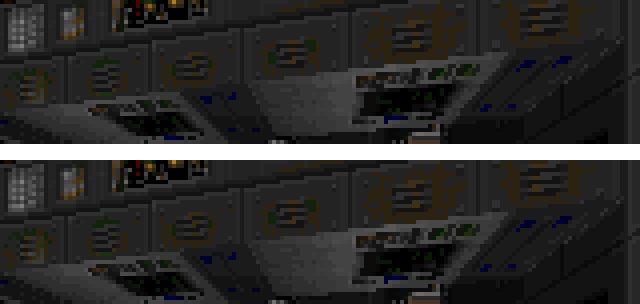

# The bugs of the original, fixed

The general instruction of the author (2026-11-26) asks the port not to
reproduce the bugs of the original that are about safety or tied to its
language: reads and writes out of bounds, uninitialized values,
overflows, undefined behavior. Where the checks compare against the
original, the original is fixed in its local copy (`engine/`), for the
checks only, and each fix is recorded here. Nothing goes upstream.

Each fix is marked in the code by `FIX of the port (doc/bugs.md, bug N)`.
The expected outputs of `tst/` were recorded again on the engine all in
C with the fixes (2026-11-26): the simulation is the same in every test,
and only pixels changed, in 13 of the 21 tests.

## Bug 1: a sprite reads past its column

`R_DrawMaskedColumn` (`r_things.c`) draws each post of a column of a
sprite (or of a masked texture of a wall). By the rounding of the scale,
the first or the last row of the screen may fall outside the post, and
`R_DrawColumn` reads the texel there: before the post, or past it, into
the next post, and past the end of the lump at the last post. In the
zone of the original, that is the header of the next block, which has
pointers: a pixel that changes at each run.

The fix: the rows whose texel falls outside the post are not drawn.

## Bug 2: a short texture of a wall reads past its column

`R_DrawColumn` and `R_DrawColumnLow` (`r_draw.c`) wrap the texel of a
wall at 128 rows. A texture shorter than 128 rows (in E1M2, among the
tests) is read past its column: the "tutti-frutti" of the original,
garbage on screen where the texture should repeat.

The fix: the column of a wall wraps at the height of its texture
(`dc_texheight`, set by `R_RenderSegLoop` in `r_segs.c`), by a mask when
it is a power of two and by a modulo otherwise. Textures of 128 rows or
more, the sky, and the sprites wrap at 128, as in the original.



## The check

A build of the engine all in C with AddressSanitizer, over the test
platform with no bytes after a block, finds no read or write out of
bounds in the 21 tests:

```
make OUT=/tmp/asan /tmp/asan/doom-c-tst \
     CFLAGS="-std=gnu99 -O1 -g -w -fsanitize=address -fsanitize-recover=address \
             -DTST_TAIL=0 -DDISABLE_SDL2MIXER=1 -DDISABLE_SDL2NET=1 -Icfg \
             -Iengine/src -Iengine/src/doom -Iengine/textscreen -Iengine/pcsound \
             -Iengine/opl $(sdl2-config --cflags)" \
     SDL_L="$(sdl2-config --libs) -fsanitize=address"
BIN=/tmp/asan/doom-c-tst ASAN_OPTIONS=detect_leaks=0 tst/run.sh
```

Not checked: uninitialized values (the blocks of the test platform are
cleared, as `calloc` gives them), and the paths that no test reaches.
